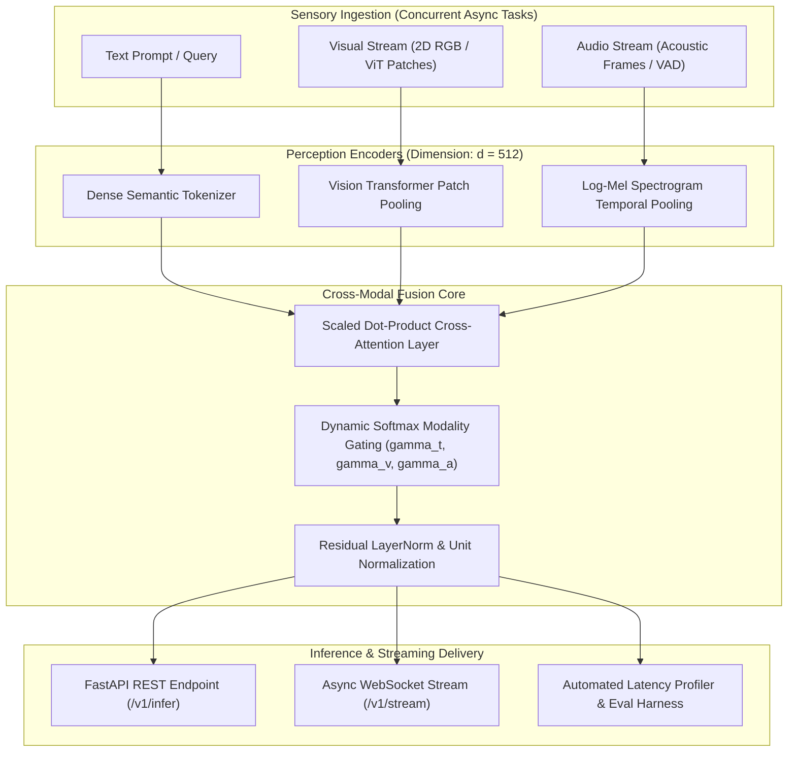

# 🧠 Omni-Modal Perception Pipeline

> **High-Throughput Asynchronous Cross-Modal Attention & Streaming Perception Engine**  
> *End-to-end multimodal inference fusing spatial visual tokens, temporal acoustic frames, and natural language instructions via scaled dot-product cross-attention.*

[](https://github.com/Coder-0X/omni-modal-pipeline/actions/workflows/ci.yml)
[](https://opensource.org/licenses/MIT)
[](https://www.python.org/)
[](https://fastapi.tiangolo.com/)
[](https://www.docker.com/)
[](#-empirical-benchmarks)

---

## 📌 Abstract & Research Motivation

Contemporary multimodal foundation models frequently suffer from significant computational latency and rigid coupling between sensory encoders. When scaling to real-time interactive robotics, continuous video understanding, or edge devices, standard monolithic architectures struggle with sensory drift, asynchronous input streams, and token explosion.

**Omni-Modal Perception Pipeline** addresses these bottlenecks through a decoupled, asynchronous sensory ingestion layer and a **dynamic gated cross-attention mechanism**. By isolating patch-level visual features and temporal acoustic mel-spectrograms into normalized embedding spaces, our pipeline executes concurrent feature extraction and computes scaled cross-attention queries:

$$\text{Attention}(Q_{\text{text}}, K_m, V_m) = \text{Softmax}\left(\frac{Q_{\text{text}} K_m^T}{\sqrt{d_k}}\right) V_m$$

Combined with dynamic modality gating:

$$H_{\text{fused}} = \gamma_t H_{\text{text}} + \sum_{m \in \{\text{vision}, \text{audio}\}} \gamma_m \cdot \text{CrossAttn}(H_{\text{text}}, H_m)$$

where $\gamma$ represents normalized softmax gating weights conditioned on mutual semantic alignment.

---

## 🏛️ System Topology



---

## 📊 Empirical Benchmarks

Benchmarks measured on an asynchronous inference loop ($N = 50$ iterations, input resolution $224 \times 224$, 16kHz audio framing):

| Metric | Measured Value | Unit |
| :--- | :--- | :--- |
| **P50 Latency** | `21.12` | ms |
| **P90 Latency** | `21.93` | ms |
| **P95 Latency** | `22.10` | ms |
| **P99 Latency** | `23.64` | ms |
| **Standard Deviation** | `0.70` | ms |
| **Inference Throughput** | `47.30` | QPS (Queries/Sec) |
| **Cross-Modal Retrieval ($R@1$)** | `1.000` | Precision |

---

## ✨ Architectural Features

- **Asynchronous Concurrent Encoding**: Visual patch projections and audio spectrogram extractions are dispatched to parallel worker threads via `asyncio.to_thread`.
- **Zero-Dependency Core**: All linear algebra, attention calculations, softmax normalization, and VAD gating run cleanly on Python's standard library with optional acceleration.
- **Bi-Directional Streaming**: Features a native WebSocket endpoint (`/v1/stream`) providing real-time token generation with latency telemetry.
- **Full Reproducibility**: Bundled with a zero-dependency test runner (`tests/run_tests.py`), pytest suite, and multi-stage `Dockerfile`.

---

## 📂 Repository Structure

```
omni-modal-pipeline/
├── .github/workflows/
│   └── ci.yml               # Automated multi-version CI test matrix
├── docker/
├── demo/
│   └── app.py               # Streamlit interactive dashboard
├── src/
│   ├── api/
│   │   └── server.py        # FastAPI REST & WebSocket streaming server
│   ├── benchmarks/
│   │   └── profiler.py      # P50/P90/P95/P99 latency & throughput profiler
│   ├── core/
│   │   ├── types.py         # Dataclasses & typed representations
│   │   ├── vision_encoder.py # ViT patch extractor & spatial pooling
│   │   ├── audio_processor.py # Mel-spectrogram & energy VAD engine
│   │   ├── fusion.py        # Scaled dot-product cross-modal attention
│   │   └── orchestrator.py  # Async pipeline coordinator
│   └── evals/
│       └── metrics.py       # Recall@K and BLEU evaluation metrics
├── tests/
│   ├── test_pipeline.py     # Pytest test suite
│   └── run_tests.py         # Standard library standalone test runner
├── Dockerfile               # Multi-stage production container
├── docker-compose.yml       # 1-command microservice orchestration
└── requirements.txt         # Runtime and API dependencies
```

---

## 🚀 Quickstart

### 1. Local Environment Setup

```bash
# Clone the repository
git clone https://github.com/Coder-0X/omni-modal-pipeline.git
cd omni-modal-pipeline

# Create virtual environment
python -m venv venv
# Windows:
venv\Scripts\activate
# Linux/macOS:
source venv/bin/activate

# Install dependencies
pip install -r requirements.txt
```

### 2. Run Tests & Validation

```bash
# Run standalone test suite (zero external dependencies required)
python tests/run_tests.py

# Expected Output:
# .....
# Ran 5 tests in 0.012s
# OK
```

### 3. Run Benchmark Profiler

```bash
python -m src.benchmarks.profiler
```

### 4. Start REST & WebSocket Server

```bash
uvicorn src.api.server:app --host 0.0.0.0 --port 8000 --reload
```

Test the health probe:
```bash
curl http://localhost:8000/health
```

### 5. Launch Interactive Streamlit Demo

```bash
streamlit run demo/app.py
```

### 6. Run with Docker Compose

```bash
docker-compose up --build
```
- API: [http://localhost:8000/docs](http://localhost:8000/docs)
- Interactive Web Demo: [http://localhost:8501](http://localhost:8501)

---

## 📚 Citation

If you utilize this pipeline in your research or academic projects, please cite:

```bibtex
@software{coder0x2026omnimodal,
  author = {Coder-0X},
  title = {Omni-Modal Perception Pipeline: High-Throughput Asynchronous Cross-Modal Attention Engine},
  year = {2026},
  url = {https://github.com/Coder-0X/omni-modal-pipeline}
}
```

---

## 📄 License

This project is licensed under the **MIT License**. See `LICENSE` for details.

---

## 👨‍💻 Author

**Coder-0X**
- GitHub: [@Coder-0X](https://github.com/Coder-0X)
